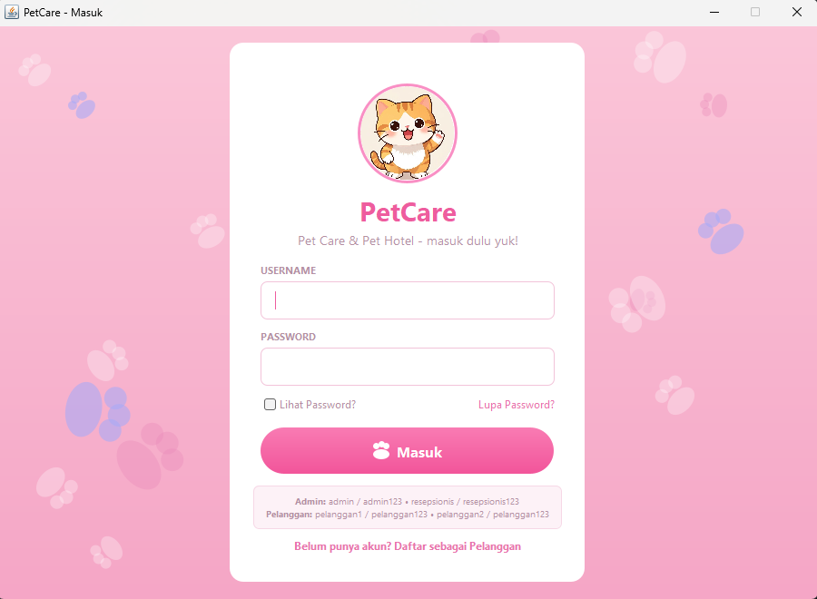
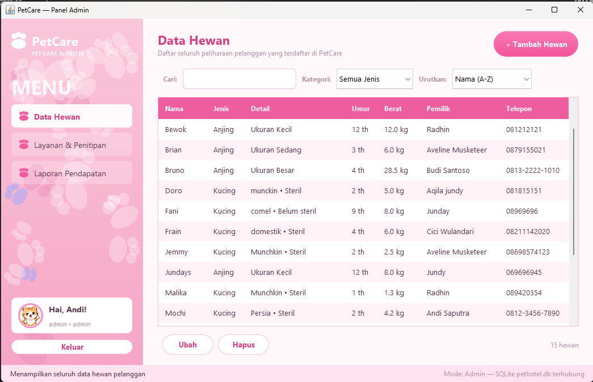
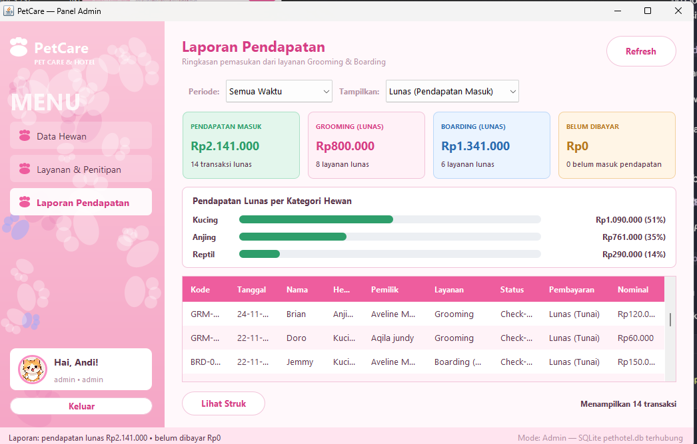

# 🐾 PetCare — Sistem Informasi Pet Care & Pet Hotel

Aplikasi desktop berbasis **Java Swing** dan **SQLite** untuk mengelola penitipan (*boarding*) dan perawatan (*grooming*) hewan peliharaan. Dibuat sebagai **Tugas Besar Pemrograman Berorientasi Objek (SYS61516)** dengan arsitektur berlapis (`model`, `dao`, `view`, `view_need`, `util`, `db`) dan antarmuka kustom bertema pastel.

- **Bahasa & UI**: Java (Swing + Java 2D Custom Painting)
- **Database**: SQLite (embedded lokal `pethotel.db`, tanpa server terpisah)
- **Keamanan Password**: Hash SHA-256 (`MessageDigest`)
- **Dokumentasi Arsitektur**: Lihat [DOKUMENTASI_KODE.md](DOKUMENTASI_KODE.md)

---

## ✨ Fitur Utama

- **Autentikasi & Registrasi Pelanggan**  
  Login tervalidasi dengan hash SHA-256 serta dialog pendaftaran akun baru (`pelanggan`) langsung dari layar masuk.
- **Dua Tampilan Peran (*Dual POV*: Admin & Portal Pelanggan)**
  - **Admin / Resepsionis**: melihat seluruh data hewan pelanggan, mengelola seluruh layanan, memajukan status perawatan, memproses pelunasan, mencari/memfilter/mengurutkan layanan, serta membuka **Laporan Pendapatan**.
  - **Pelanggan**: mendapatkan tema **Portal Pelanggan**, hanya mengelola hewan miliknya sendiri (*Hewan Saya*), memesan layanan (*Layanan Saya*), membayar tagihan saat sudah *Check-out*, dan mengunduh struk.
- **Manajemen Data Hewan (`Kucing`, `Anjing`, `Reptil`)**  
  Form dinamis menyesuaikan jenis hewan (ras & status steril untuk Kucing, ukuran badan untuk Anjing, suhu kandang untuk Reptil), dilengkapi fitur pencarian *live*, filter kategori, dan pengurutan.
- **Layanan Grooming & Boarding + Tracking Status**  
  Pembuatan kode transaksi otomatis (`GRM-xxxx` / `BRD-xxxx`), kalkulasi perkiraan biaya *real-time*, serta alur status bertahap:  
  `Check-in` → `Perawatan` → `Check-out`.
- **Pembayaran Saat Check-out & Struk Visual PNG**  
  Layanan baru berstatus **Belum Bayar** dan baru dapat dilunasi ketika berstatus **Check-out** (mendukung *Tunai* dengan hitung kembalian otomatis, *QRIS*, *Transfer Bank*, dan *E-Wallet*). Setelah **Lunas**, pengguna dapat melihat pratinjau dan mengunduh struk resmi berformat `.png`.
- **Laporan Pendapatan & Chart Kategori Hewan (Khusus Admin)**  
  Menampilkan total **Pendapatan Masuk** (hanya dari transaksi berstatus `LUNAS`), rincian *Grooming* vs *Boarding*, kartu **Belum Dibayar** terpisah, filter periode bulan, serta grafik batang hijau pendapatan per kategori hewan.

---

## 💰 Tarif & Aturan Bisnis

| Jenis Hewan | Tarif Boarding / Hari | Biaya Dasar Grooming |
|---|---:|---:|
| **Kucing** | Rp50.000 | Rp60.000 |
| **Anjing** | Rp70.000 | Kecil: Rp60.000 • Sedang: Rp80.000 • Besar: Rp100.000 |
| **Reptil** | Rp40.000 | Rp45.000 |

- **Paket Grooming**: `Basic (x1.0)`, `Deluxe (x1.5)`, `Spa (x2.0)` dari biaya dasar grooming hewan.
- **Diskon Boarding**: Menginap **≥ 7 hari** otomatis mendapat **diskon 10%**.

---

## 🔑 Akun Demo

Data awal otomatis dibuat saat aplikasi pertama kali dijalankan dari [`src/db/pethotel.sql`](src/db/pethotel.sql):

| Peran | Username | Password |
|---|---|---|
| Admin | `admin` | `admin123` |
| Pelanggan 1 | `pelanggan1` | `pelanggan123` |

---

## 📁 Struktur Proyek

```text
src/
├── Main.java               # Entry point aplikasi (LookAndFeel, init SQLite, LoginFrame)
├── db/
│   └── pethotel.sql        # Skema tabel & data awal (seed)
├── model/                  # Class OOP (Hewan, Kucing/Anjing/Reptil, Layanan, Tagihan, Enum)
├── dao/                    # Query JDBC & SQLite (UserDAO, HewanDAO, LayananDAO)
├── util/                   # Koneksi DB, SHA-256, FormatUang, Toaster, StrukGenerator, dll.
├── view/                   # Layar & dialog aplikasi (Login, MainFrame, Panel, Dialog)
├── view_need/              # Komponen Swing kustom (PinkTable, PillButton, PinkDialog, dll.)
└── resources/
    └── kucing.png          # Aset maskot aplikasi
```

Untuk penjelasan lengkap konsep OOP, alur database, hingga detail kode tiap berkas, baca **[DOKUMENTASI_KODE.md](DOKUMENTASI_KODE.md)**.

---

## 🚀 Cara Menjalankan

1. **Clone repository ini**:
   ```bash
   git clone https://github.com/RadhinGH/PetCare-Pet-Hotel.git
   ```
2. **Unduh driver SQLite JDBC**:  
   Unduh `sqlite-jdbc` (versi `3.x`) dari rilis resmi [xerial/sqlite-jdbc](https://github.com/xerial/sqlite-jdbc/releases).
3. **Buka di IntelliJ IDEA**:
   - Buka folder proyek melalui **File → Open**.
   - Tambahkan file `.jar` `sqlite-jdbc` ke project melalui **File → Project Structure → Modules → Dependencies → `+` → JARs or Directories**.
   - Pastikan SDK Java sudah terkonfigurasi.
4. **Jalankan [`src/Main.java`](src/Main.java)**:  
   File database `pethotel.db` akan dibuat, diisi data contoh, dan dimigrasi secara otomatis di folder proyek saat pertama kali dijalankan.

---

## 📸 Screenshot

### Layar Login


### Tampilan Admin


### Laporan Pendapatan

